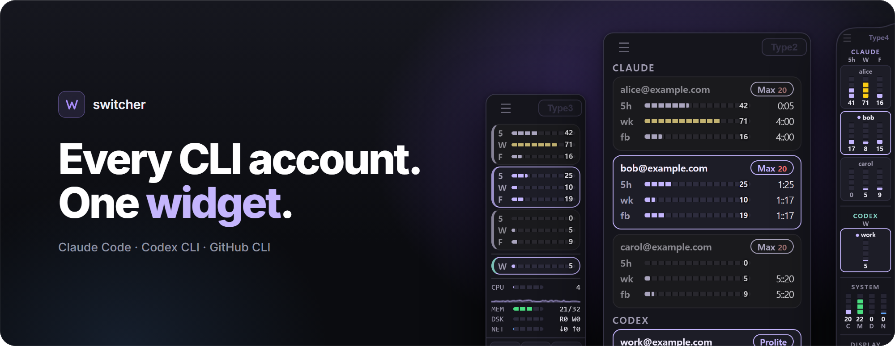
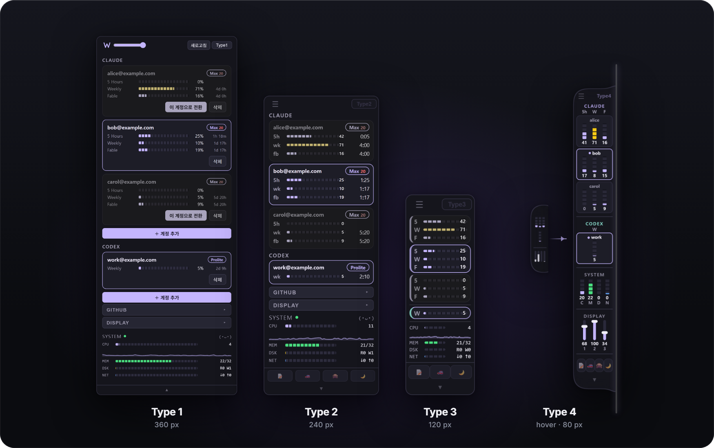
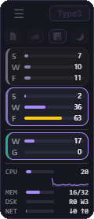
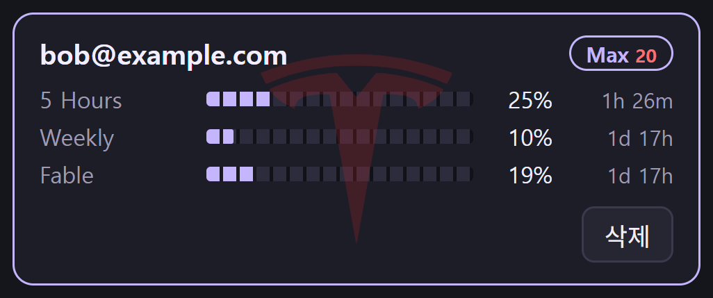
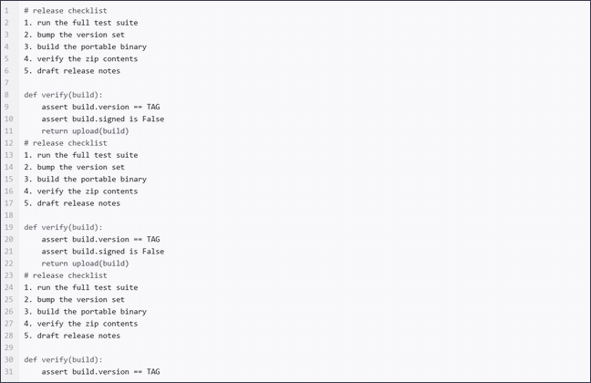
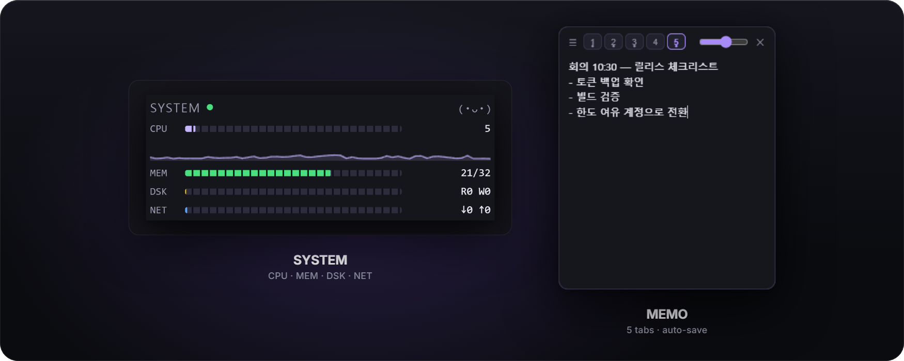

<p align="center">
  <a href="https://github.com/Youkamii/switcher/releases/tag/v1.8.5">
    
  </a>
</p>

<p align="center">
  <a href="https://www.npmjs.com/package/switcher-widget"></a>
  <a href="https://www.npmjs.com/package/switcher-widget"></a>
  <a href="LICENSE"></a>
  
  
</p>

<p align="center">
  <strong>Claude Code · Codex CLI · GitHub CLI 계정을 한 위젯에서 바꿉니다.</strong><br />
  로그인은 계정마다 한 번, 그다음부터는 클릭 한 번. 사용량과 초기화 시간은 늘 보입니다.
</p>

<p align="center">
  <a href="#설치">설치</a> ·
  <a href="#세-가지-모드">모드</a> ·
  <a href="#엣지--벽에-붙는-액체-위젯">엣지</a> ·
  <a href="#tfsd-자율주행">TFSD</a> ·
  <a href="#조작-치트시트">치트시트</a> ·
  <a href="#데이터와-보안">보안</a> ·
  <a href="#문제-해결">문제 해결</a>
</p>

<p align="center">
  <sub>
    <strong>한국어</strong> ·
    <a href="docs/README.en.md">English</a> ·
    <a href="docs/README.ja.md">日本語</a> ·
    <a href="docs/README.zh-CN.md">简体中文</a> ·
    <a href="docs/README.zh-TW.md">繁體中文</a> ·
    <a href="docs/README.hi.md">हिन्दी</a>
  </sub>
</p>

<br />

## 설치

Node.js 18 이상이면 두 줄입니다. 첫 실행 때 npm 패키지와 같은 버전의 공식 릴리스를 내려받습니다.

```sh
npm install -g switcher-widget
switcher
```

<p align="center">
  <a href="https://github.com/Youkamii/switcher/releases/download/v1.8.5/switcher-win-x64-latest.zip"></a>
  &nbsp;
  <a href="https://github.com/Youkamii/switcher/releases/download/v1.8.5/switcher-mac-arm64-latest.zip"></a>
</p>

전환할 [Claude Code](https://docs.anthropic.com/en/docs/claude-code)나 [Codex CLI](https://github.com/openai/codex)는 따로 설치되어 있어야 합니다.

> [!NOTE]
> **첫 실행 때 "알 수 없는 게시자" 경고가 뜹니다.** 배포 파일에 유료 코드 서명이 없어서 그렇지, 파일이 바뀐 것은 아닙니다. 출처가 `github.com/Youkamii/switcher`인지 확인하고 이렇게 여세요.
> - **Windows** — SmartScreen 창에서 **추가 정보 → 실행**
> - **macOS** — 막히면 **시스템 설정 → 개인정보 보호 및 보안**으로 내려가 **그래도 열기**. 터미널이 편하면 `xattr -dr com.apple.quarantine switcher.app` 한 줄로 다운로드 표시를 떼도 됩니다.
> - 이 경고는 브라우저가 받은 파일에 붙는 다운로드 표시 때문입니다. `npm install -g switcher-widget`로 설치하면 Windows에서는 표시가 붙지 않아 경고 없이 실행되고, macOS도 같은 원리입니다.

<details>
<summary><strong>계정 추가하기</strong> — Claude · Codex · GitHub</summary>
<br />

1. 일반 모드에서 Claude 또는 Codex 옆의 **계정 추가**를 누릅니다.
2. 위젯이 보여주는 로그인 주소를 브라우저에서 엽니다.
3. Claude는 브라우저의 코드를 위젯 입력칸에 붙여넣고, Codex는 브라우저에서 15분 유효 일회용 코드를 입력합니다.
4. 로그인이 끝나면 카드가 생깁니다. 지금 활성 계정은 바뀌지 않습니다.

Codex는 ChatGPT에서 장치 코드 인증이 켜져 있어야 합니다. 개인 계정은 **설정 → 보안 → Codex 장치 코드 인증**, 팀·비즈니스 계정은 관리자의 워크스페이스 권한에서 켭니다.

[GitHub CLI](https://cli.github.com)가 설치되어 있으면 GITHUB 섹션이 나타납니다. **+ 계정 추가**를 누르고 브라우저에서 장치 코드를 승인하면 됩니다.
</details>

<details>
<summary><strong>API 키로 사용하기</strong> — Claude · OpenAI</summary>

일반 모드에서 CLAUDE·CODEX 제목 줄의 **API 키 추가**를 누르고 키를 붙여 넣습니다. 계정은 고르지 않아도 됩니다 — 앱이 그 키의 계정을 찾아 그 계정 밑에 넣고, 찾지 못할 때만 어느 계정인지 묻습니다. 특정 계정에 직접 넣으려면 그 계정 카드의 **API 키 추가**를 누릅니다. **저장**을 누르면 해당 계정의 키 목록에 추가됩니다. **저장하고 사용**을 누르면 그 키가 CLI에 적용됩니다 — Claude Code는 실행 중인 세션에도 바로, Codex는 다음 실행부터입니다. 나중에 쓰려면 저장한 키 옆의 **사용**을 누르세요. 미니멀·엣지 모드에서는 사용 중인 계정 카드를 한 번 더 누르면 그 계정의 키로 넘어가고, 다시 누르면 구독으로 돌아옵니다. 한 계정에 여러 키를 추가할 수 있습니다. 이전 버전에서 등록한 키는 **기존 키 연결**에서 소속 계정을 한 번 선택합니다.

API 사용은 구독과 별도 과금됩니다. 플랜에 포함된 월간 API 크레딧은 터미널의 대화형 Claude Code에는 쓰이지 않으므로, 대화형 세션을 API 키로 쓰려면 Console에서 구매한 크레딧이 필요합니다. 구독 계정으로 **전환**하거나 API를 **해제**하면 설정을 복원합니다. 저장 키는 macOS 키체인·Windows DPAPI로 보호하며 Codex의 활성 인증 파일에도 키가 기록됩니다. 연결 목록에서 사용/해제·확인·키 교체·삭제를 할 수 있습니다. Claude API 카드는 같은 Console의 로그인으로 **조직 선불 잔액**을 조회합니다. 일반 키만 있을 때는 **대시보드 가져오기**로 개인 Console의 **조직 크레딧**을 가져올 수 있습니다. 세 모드 모두에 금액과 확인 시각이 표시됩니다. OpenAI는 카드에서 공식 결제 화면을 엽니다. 등록 중에도 제목을 잡고 창을 이동할 수 있습니다.

[사용법·오류 해결](docs/API_CONNECTIONS.md) · [세 모드와 API 화면](docs/design/complete-preview.png) · [검증 범위](docs/IMPLEMENTATION_STATUS.md)

</details>


<br />

## 왜 switcher인가

Claude Code와 Codex CLI는 한 번에 한 계정만 씁니다. 계정이 여럿이면 한도가 찰 때마다 로그아웃하고 브라우저 인증을 다시 거쳐야 하고, 어느 계정에 여유가 남았는지도 따로 확인해야 합니다. switcher는 CLI가 쓰는 로컬 인증 저장소를 계정별로 보관했다가 통째로 바꿔 끼웁니다.

| | 손으로 | switcher |
| --- | --- | --- |
| 계정 바꾸기 | 로그아웃 → 브라우저 인증 → 코드 붙여넣기 | 위젯에서 클릭 한 번 |
| 남은 한도 | 계정마다 로그인해서 확인 | 비활성 계정까지 한 화면에 |
| 한도 도달 | 작업이 멈추고 나서 알게 됨 | TFSD를 켜 두면 90%에서 미리 갈아탐 |

- 공급자가 주는 **5시간·주간 사용량 창**과 초기화 시간을 보여주고, 비활성 프로필의 토큰도 갱신해 사용량을 계속 업데이트합니다.
- Claude 구독 등급과 **Max 배수(5x·20x)를 서버 기준으로 동기화**합니다. 업그레이드해도 다시 로그인할 필요가 없습니다.

<br />

## 세 가지 모드

<p align="center">
  
</p>

오른쪽 위 모드 버튼으로 순환합니다(일반 모드에서는 화면 위 탭으로도 고릅니다). 하나의 위젯이 전체 제어 화면부터 폭 80px 패널까지 줄어듭니다.

| 모드 | 역할 | 계정 전환 |
| --- | --- | --- |
| **1 일반** | 계정 추가·삭제, API 키, 모든 도구가 있는 전체 화면. 섹션 제목을 끌어 순서를 바꿀 수 있습니다 | 카드의 버튼 |
| **2 미니멀** | 라벨과 사용량 막대만 남긴 폭 120px 위젯 | 카드 더블클릭 |
| **3 엣지** | 화면 가장자리에 맺힌 액체 손잡이. 마우스를 대면 폭 80px 패널 | 카드 클릭 |

**구독 ↔ API 키.** 미니멀·엣지에서 사용 중인 계정에 저장한 API 키가 있으면 카드에 `API ›`가 붙습니다. 그 카드를 한 번 더 누르면(미니멀은 더블클릭) 그 계정의 키로 넘어가고, 다시 누르면 구독으로 돌아옵니다. API를 쓰는 동안에는 그 계정이 API 색 틀로 묶이고, 접힌 엣지 손잡이는 사용량 막대 대신 `API`를 보입니다. API 사용은 구독과 별도로 과금됩니다.



**작업 화면을 가리지 않습니다.**

- 미니멀의 빈 영역은 클릭과 드래그가 뒤 창으로 통과합니다.
- 투명도는 배경부터 그래프까지 단계적으로 줄어들고, 최저 단계에서는 사용량 막대만 남습니다.
- 🙈를 켜면 이메일과 GitHub 계정명이 흐려져 화면 공유 중에도 안전합니다.

<br clear="all" />

## 엣지 — 벽에 붙는 액체 위젯


**v2.0**의 새 모드입니다. 위젯이 화면 좌우 가장자리 중 가까운 벽에 손잡이로 맺혀 있다가, 마우스를 대면 부풀어 패널이 되고 벗어나면 다시 스며듭니다.

- **손잡이** — 접혀 있어도 Claude·Codex 현재 계정의 사용량 창(예: 5h·W·F)과 SYSTEM(CPU·MEM·DSK·NET)이 얇은 막대로 보입니다.
- **패널** — 모든 계정이 세로 세그먼트 막대와 %로 쌓이고, 아래로 SYSTEM, DISPLAY(모니터별 세로 밝기 슬라이더), 도구 독이 이어집니다. 사용 중인 계정은 액센트색 테두리와 이름 앞 점으로 표시됩니다.
- **전환** — 다른 계정 카드를 짧게 클릭하면 바로 바뀝니다. 사용 중인 계정을 한 번 더 클릭하면 그 계정의 API 키로, 다시 클릭하면 구독으로 돌아옵니다.
- **남은 시간** — 패널을 꾹 누르고 있으면 % 자리에 초기화까지 남은 시간이 뜹니다. `4d`는 파랑, `2h`는 초록, `52m`은 빨강.
- **접힘** — 마우스가 벗어나고 약 0.5초 뒤 손잡이로 돌아갑니다. ☰를 끌어 화면 가운데를 넘겨 놓으면 반대쪽 벽으로 옮겨 붙습니다.
- **손잡이 옮기기** — 펼친 패널의 ☰를 잡고 옮기면, 접혔을 때의 손잡이가 **놓은 자리**에 섭니다. ☰는 패널 맨 위와 맨 아래에 하나씩, 벽 쪽에 있습니다. 화면 위쪽에 놓으면 패널이 손잡이 아래로, 아래쪽에 놓으면 손잡이 위로 열려서 어디에 두든 ☰가 손잡이 바로 옆에 옵니다. 놓은 자리와 벽은 위젯을 다시 켜도 그대로입니다.
- 펼친 패널은 마우스를 그대로 받습니다. 접힌 상태에서는 손잡이 밖만 뒤 창으로 통과합니다.

<sub>데모의 계정 이름은 예시이고 커서는 편집으로 넣었습니다.</sub>

<br clear="all" />

## TFSD 자율주행



**Token Full Self-Driving.** 활성 계정의 사용량 창 하나가 90%에 닿으면, 모든 창에 여유가 있는 계정 중 가장 넉넉한 곳으로 알아서 전환합니다.

- 창 아래 ▲를 눌러 도구 독을 펼치고 🚗를 켜거나, 트레이 설정에서 켭니다. 켜져 있으면 활성 카드에 T 워터마크가 보입니다.
- 90%를 넘긴 창이 모두 30분 안에 초기화되면 전환하지 않고 기다립니다.
- 직접 계정을 바꾸면 그 즉시 꺼집니다.
- 전환 기록은 `~/.switcher/tfsd-history.log`에 남습니다. 계정 이름과 이메일이 평문으로 포함될 수 있습니다.

<br clear="all" />

## 작업을 끊지 않는 도구

<p align="center">
  
</p>

**블랙 모니터**(🌙)는 화면을 검은 오버레이로 덮습니다. 커서를 움직이면 주변만 연기처럼 걷히고, 마우스를 1~2초 세게 흔들거나 `Esc`를 누르면 풀립니다. Windows는 DDC/CI를 지원하는 모니터의 하드웨어 밝기도 함께 낮춥니다. macOS는 오버레이만 쓰며 전체 화면 앱이 열린 별도 Space는 덮지 못합니다.

<p align="center">
  
</p>

**SYSTEM**은 CPU·메모리·디스크·네트워크를 60초 그래프와 함께 보여주고, **MEMO**(📝)는 자동 저장되는 탭 5개를 독립 투명도의 작은 창으로 띄웁니다. **클램셸 모드**(☕)는 노트북 덮개를 닫아도 터미널 작업을 이어 가고, **GitHub 전환**은 `gh` 계정과 HTTPS Git 인증을 함께 바꿉니다.

| 기능 | Windows | macOS |
| --- | :---: | :---: |
| Claude · Codex 전환, 사용량, TFSD | ✓ | ✓ |
| 엣지(벽 붙임) | ✓ | ✓ |
| GitHub 전환 | ✓ | ✓ |
| 클릭 통과 · 투명도 | ✓ | ✓ |
| DISPLAY 밝기 | 외장 모니터 (DDC/CI) | 내장 디스플레이 |
| 블랙 모니터 | ✓ | ✓ ¹ |
| 클램셸 슬립 방지 | ✓ | ✓ |
| 자동 업데이트 | ✓ | ✓ ² |
| 자동 실행 · 앱 색감 6종 · UI 언어 6개 | ✓ | ✓ ³ |

<sub>¹ 전체 화면 앱이 열린 별도 Space는 덮지 못함 · ² 구현·배포됨, 최신 경로의 Mac 실기기 검증은 남아 있음 · ³ 자동 실행은 macOS 13+</sub>

<details>
<summary><strong>클램셸 모드와 GitHub 전환 자세히</strong></summary>
<br />

**클램셸** — ☕를 한 번 누르면 다음 덮개 열림까지, 두 번 누르면 감시 프로세스가 살아 있는 동안 앱을 다시 실행해도 계속 유지됩니다. 정상 종료·재부팅 때 원래 설정을 복원하고, 감시 프로세스가 비정상 종료되면 다음 실행 때 복구한 뒤 기능을 끕니다.

- Windows: 현재 전원 구성표의 AC·배터리 덮개 동작을 각각 보관한 뒤 `아무 작업 안 함`으로 바꿉니다. 켜진 동안 구성표가 바뀌면 새 구성표도 보관하고, 해제할 때는 switcher가 바꾼 값만 되돌립니다.
- macOS: `SleepDisabled`를 보관·복원하며, 켤 때 관리자 승인을 한 번 요청합니다.

**GitHub** — [GitHub CLI](https://cli.github.com)에 로그인된 `github.com` 계정을 전환합니다. HTTPS 리모트를 위해 `gh auth setup-git`을 쓰므로 GitHub CLI의 전역 HTTPS 자격증명 연결에도 반영됩니다. SSH 리모트, `git config user.name/email`, VS Code·Copilot 로그인은 바뀌지 않습니다. GitHub Enterprise 호스트는 대상이 아닙니다.
</details>

<br />

## 조작 치트시트

| 하고 싶은 것 | 방법 |
| --- | --- |
| 보기 모드 바꾸기 | 오른쪽 위 모드 버튼으로 1 일반 → 2 미니멀 → 3 엣지 순환. 일반 모드에서는 위쪽 탭, 엣지에서는 펼친 패널 위의 **3 엣지** 버튼 |
| 계정 전환 | 일반은 카드의 버튼, 미니멀은 **카드 더블클릭**, 엣지는 **카드 클릭** |
| 구독 ↔ API 키 | 미니멀·엣지에서 `API ›`가 붙은 사용 중인 계정 카드를 **한 번 더** 누르면 그 계정의 API 키, **다시** 누르면 구독 (미니멀은 더블클릭) |
| 초기화까지 남은 시간 | 엣지 패널을 **꾹 누르기** |
| 엣지 벽 옮기기 | ☰를 끌어 화면 반대편에 놓기 |
| 엣지 손잡이 높이 | ☰(패널 맨 위·맨 아래)를 잡고 원하는 높이에 놓기 |
| 섹션 순서 바꾸기 | 일반 모드에서 섹션 제목을 끌어서 배치 |
| 위젯 아래 창 조작 | 미니멀의 빈 영역, 엣지의 접힌 손잡이 밖은 클릭이 뒤로 통과 |
| 도구 독 열기 | 창 아래 **▲** 손잡이. 📝 메모 · 🚗 TFSD · 🙈 가리기 · ☕ 클램셸 · 🌙 블랙 모니터 |
| 블랙 모니터 해제 | 마우스를 1~2초 세게 흔들거나 `Esc` |
| 클램셸 모드 | ☕ 한 번은 다음 덮개 열림까지, 두 번은 계속 유지 |
| 완전히 종료 | 트레이 메뉴의 **종료**. 창 닫기는 종료가 아닙니다 |

Windows는 알림 영역, macOS는 메뉴 막대의 **W** 아이콘으로 상주합니다. 언어, 자동 업데이트, 자동 실행, TFSD, 앱 색감, 표시할 섹션은 트레이 설정에서 바꿉니다. 트레이의 **업데이트 확인**은 적용 뒤 앱을 다시 시작합니다.

<br />

## 데이터와 보안

switcher 전용 서버는 없습니다. 앱은 로컬 CLI 인증 저장소를 읽고 쓰며, 사용량 조회와 토큰 갱신은 Anthropic 또는 OpenAI 서비스에 직접 요청합니다. GitHub 인증은 `gh`가 관리하고, 업데이트는 GitHub Releases에서 받습니다.

> [!IMPORTANT]
> 계정 프로필에는 실제 인증 자격증명이 들어 있습니다. 복사본은 앱 전용 암호화 없이 로컬 파일로 저장되며, Unix 계열에서는 `0600` 권한으로 만듭니다. `~/.switcher`, `~/.claude`, `~/.codex` 안의 인증 파일을 Issue나 로그에 첨부하지 마세요.

전환 순서는 일부러 고정되어 있습니다. **① 현재 활성 인증을 현재 프로필에 백업하고 ② 그다음 선택한 프로필을 활성 위치로 복사합니다.** CLI가 자동 갱신한 최신 토큰을 잃지 않기 위해서입니다. 토큰 값은 로그와 오류 메시지에 출력하지 않습니다.

대화 기록, 메모리, 프로젝트 설정은 인증과 별개라 계정을 바꿔도 그대로입니다. **Codex 0.167.0 이상 정식 버전의 관리되는 공유 서버는 구독 계정 전환 후 자동으로 갱신합니다.** 진행 중인 작업이 끝나면 서버가 새 인증을 읽고, 연결된 Codex 터미널은 기존 대화에 다시 연결합니다. 화면에서 대기·갱신·완료·실패를 구분합니다. 공유 서버에 연결되지 않은 단독 실행·구형 CLI는 종료 후 같은 터미널에서 `codex resume`으로 이어가세요.

<details>
<summary><strong>파일 위치</strong></summary>
<br />

| 대상 | 위치 |
| --- | --- |
| Claude 활성 인증 · Windows | `~/.claude/.credentials.json` |
| Claude 활성 인증 · macOS | 키체인의 `Claude Code-credentials`. CLI 호환을 위해 파일도 함께 쓸 수 있음 |
| Codex 활성 인증 | `~/.codex/auth.json` |
| Claude 프로필 복사본 | `~/.switcher/claude/profiles/<name>/` |
| Codex 프로필 복사본 | `~/.switcher/codex/profiles/<name>/` |
| TFSD 전환 기록 | `~/.switcher/tfsd-history.log` |
</details>

<br />

## 지원 범위

| 대상 | 배포 파일 | 상태 |
| --- | --- | --- |
| Windows 10 1803+ / 11 x64 | `switcher-win-x64-latest.zip` | 지원 |
| macOS Apple Silicon | `switcher-mac-arm64-latest.zip` | 지원 |
| Windows ARM64 | x64 에뮬레이션 | 실기기 검증 대상 아님 |
| macOS Intel | 없음 | 미지원 (소스 빌드는 가능) |
| Linux | 없음 | 미지원 |

npm 설치, 자동 업데이트, [다운로드 보관함](https://github.com/Youkamii/switcher/releases/tag/v1.8.5)의 직접 다운로드 모두 같은 릴리스 파일을 씁니다.

> [!WARNING]
> 배포 파일은 Windows Authenticode나 macOS Developer ID로 서명·공증되지 않았습니다. 자동 업데이터는 GitHub 출처, 파일 크기, 내부 버전을 확인하고 npm 실행기는 고정된 GitHub 주소에서만 내려받지만, 둘 다 암호학적 서명이나 공개 체크섬은 대조하지 않습니다.

<br />

## 문제 해결

<details>
<summary><strong>처음 실행이 차단됩니다</strong></summary>
<br />
배포 파일에 코드 서명이 없어서 그렇습니다. Windows는 <strong>추가 정보 → 실행</strong>, macOS는 <strong>시스템 설정 → 개인정보 보호 및 보안 → 그래도 열기</strong>(최근 macOS는 우클릭 열기가 없습니다) 또는 터미널에서 <code>xattr -dr com.apple.quarantine switcher.app</code>. 다운로드 주소가 이 저장소의 GitHub Releases인지 먼저 확인하세요. npm으로 설치하면 다운로드 표시가 붙지 않아 Windows에서는 경고 없이 실행됩니다.
</details>

<details>
<summary><strong>Codex 계정 추가가 승인 단계에서 거부됩니다</strong></summary>
<br />
ChatGPT 계정에서 장치 코드 인증을 켜야 합니다. 개인 계정은 <strong>설정 → 보안</strong>, 팀 계정은 관리자의 워크스페이스 권한 설정을 확인하세요.
</details>

<details>
<summary><strong>계정을 바꿨는데 열려 있던 CLI는 그대로입니다</strong></summary>
<br />
Codex는 파일 교체만으로 실행 중 인증을 바꾸지 않습니다. Switcher는 관리되는 공유 서버를 찾아 현재 작업이 끝나면 자동 갱신합니다. **선택됨**은 저장된 계정 선택이며, 아래 안내가 공유 서버 반영 여부를 별도로 표시합니다. 단독 실행(`--no-daemon`), Windows 관리자 권한 실행, 구형 CLI 등 공유 서버에 연결되지 않은 세션은 `codex resume`으로 다시 여세요. 실패 시 위젯 새로고침으로 갱신을 재시도할 수 있습니다. Claude에서도 이전 인증이 유지되면 CLI를 다시 시작하세요.
</details>

<details>
<summary><strong>Windows에서 API 키를 어디에 추가하나요?</strong></summary>
<br />
계정별 키를 지원하는 빌드에서는 일반 모드의 **계정 추가**로 로그인한 다음, 제목 줄의 **API 키 추가**(계정을 알아서 찾습니다) 또는 생성된 계정 카드 하단의 **API 키 추가**를 누릅니다. 공개 버전 v2.1.2의 경로는 **계정·API 추가 → API 키 등록**입니다.
</details>

<details>
<summary><strong>프로필을 지웠는데 전환하니 다시 생깁니다</strong></summary>
<br />
삭제는 보관함 사본만 지우고 로그인은 남깁니다. 전환할 때 현재 로그인 계정을 자동 백업하므로 활성 계정의 프로필은 다시 생길 수 있습니다. 완전히 정리하려면 먼저 다른 계정으로 전환한 뒤 지우세요.
</details>

<details>
<summary><strong>화면 밝기가 바뀌지 않습니다</strong></summary>
<br />
Windows는 모니터 OSD 설정에서 DDC/CI를 켜세요. 일부 모니터와 연결 방식은 DDC/CI를 지원하지 않습니다. macOS 빌드는 내장 디스플레이만 지원하며 외장 모니터에는 미지원 안내가 표시됩니다.
</details>

<br />

## 개발과 기여

```sh
git clone https://github.com/Youkamii/switcher.git
cd switcher
npm ci
npm run tauri dev
```

| 작업 | 명령 |
| --- | --- |
| 프론트 좌표 회귀 테스트 | `npm test` |
| 프론트 빌드 · 타입 검사 | `npm run build` |
| Rust 검사 · 테스트 | `cd src-tauri && cargo check` · `cargo test` |
| Windows 포터블 빌드 | `npm run tauri build -- --no-bundle` |
| macOS 앱 빌드 | `npm run tauri build -- --bundles app` |

빌드 결과물은 Windows에서 `src-tauri/target/release/switcher.exe`, macOS에서 `src-tauri/target/release/bundle/macos/switcher.app`입니다.

Tauri 2 + Rust 위에 바닐라 TypeScript와 Vite로 만들었습니다. 계정 전환, 로그인(Claude는 PTY, Codex는 장치 코드), 사용량 조회, 시스템 연동은 전부 Rust 커맨드이고, 웹뷰는 Windows WebView2와 macOS WKWebView입니다. 릴리스 워크플로를 태그로 실행하면 Windows·macOS 파일이 다운로드 보관함에 올라가고 npm 게시가 이어서 돕니다.

버그 수정, 문서, 번역, 실기기 검증 모두 환영합니다. 큰 변경은 먼저 [Issue](https://github.com/Youkamii/switcher/issues)에서 방향을 맞추고, Pull Request에는 확인한 운영체제와 실행한 검사 명령을 적어 주세요. 실제 토큰, 계정 파일, `~/.switcher` 내용은 커밋·스크린샷·Issue에 절대 넣지 않습니다. macOS 검증은 [체크리스트](docs/MAC_VALIDATION_PROMPT.md)를 따릅니다.

<br />

<p align="center">
  <a href="LICENSE">MIT License</a> · 개인·상업용 모두 사용 가능<br />
  <sub>switcher는 Anthropic, OpenAI, GitHub와 제휴하거나 이들이 보증한 제품이 아닌 독립 오픈소스 프로젝트입니다.</sub>
</p>
